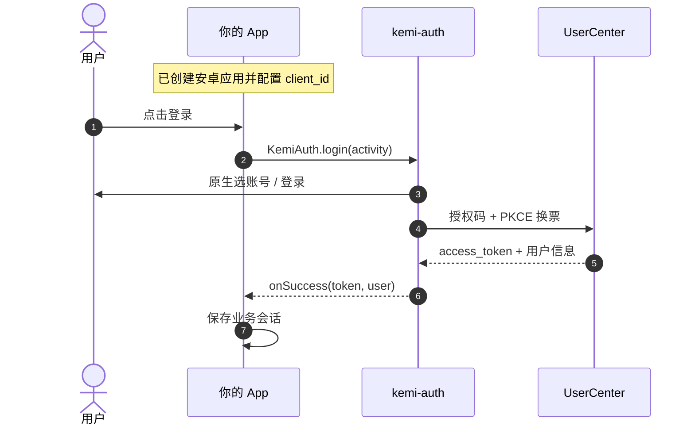

# KEMI 账号授权登录 · Android 应用接入

让用户在你的 Android App 里用 **KEMI 账号**登录。使用官方 SDK（`kemi-auth`）：公开客户端 + PKCE，**无需** `client_secret`，登录 UI 为原生界面。

**本文自成一体**：按下面步骤即可完成对接。页面右上角可下载 SDK；也可从文末链接获取。

---

## 你将得到什么

用户点击登录 → SDK 弹出选账号 / 登录界面 → 成功后回调给你：

- `token`：即 `access_token`，用于业务会话与请求用户信息  
- `user`：用户资料（`userId`、昵称、手机、邮箱等）

SDK 内部完成授权码 + PKCE 换票；你只需初始化并调用 `KemiAuth.login`。

---

## 环境

| 服务 | 地址（正式环境） | 用途 |
|------|------------------|------|
| 开发者平台 | https://kemi.newlinksz.com/kd | 注册、创建安卓应用、复制 `client_id`、下载 SDK |
| UserCenter API | https://kemi.newlinksz.com/usercenter | SDK 内部访问（授权 / 换票） |
| UserCenter Web | https://kemi.newlinksz.com/uc | 一般不必直接打开（SDK 为原生登录） |

正式环境为 HTTPS 公网地址；本机联调可改用局域网 `172.21.16.10:8401/8402/8412`。

---

## 流程



用户侧界面：

1. 本机已有账号 → 选账号（可删除本机记忆、使用其他账号）  
2. 点已有账号 → 静默换票（无网页）  
3. 无账号 / 其他账号 / token 失效 → 原生验证码或密码登录，再换票  

---

## 第一步：创建安卓应用

1. 打开 [开发者平台](https://kemi.newlinksz.com/kd) 并登录  
2. 进入 **控制台 → 应用管理 → 安卓应用 → 新建**  
3. 填写市场上架所需资料；**包名须与 App 的 `applicationId` 完全一致**  
4. 创建成功后自动开通 KEMI 授权：  
   - 回调固定为 `{包名}://oauth/callback`（无需手填，也无需在 Manifest 里配 Deep Link）  
   - 在应用详情复制 **`client_id`**  
5. 公开客户端使用 PKCE，**不要**把任何 `client_secret` 打进 APK  

---

## 第二步：获取 SDK

任选其一：

- 本页 **下载 SDK**（zip 内含 `kemi-auth-release.aar` 与本说明）  
- 或从开发者平台 Android 文档页获取最新包：  
  https://kemi.newlinksz.com/kd/docs/kemi-oidc/android  

将 aar 放到工程，例如 `app/libs/kemi-auth-release.aar`。

若你与 SDK 源码在同一仓库，也可模块依赖：

```kotlin
// settings.gradle.kts
include(":kemi-auth")

// app/build.gradle.kts
dependencies {
    implementation(project(":kemi-auth"))
    // 或 implementation(files("libs/kemi-auth-release.aar"))
}
```

ProGuard / R8：

```proguard
-keep class com.kemi.auth.** { *; }
```

---

## 第三步：初始化并登录

在 `Application` 或启动页 `onCreate`：

```kotlin
KemiAuth.init(
    context = this,
    config = KemiAuthConfig(
        clientId = "控制台复制的 client_id",
        // redirectUri 可不填：init 会按 applicationId 生成 包名://oauth/callback
        ucApiBase = "https://kemi.newlinksz.com/usercenter",
        ucWebBase = "https://kemi.newlinksz.com/uc",
    )
)
```

用户点击登录时：

```kotlin
KemiAuth.login(activity) { result ->
    result.onSuccess { auth ->
        val token = auth.token          // access_token
        val user = auth.user            // userId / nickname / ...
        // 写入你的业务 Session，后续请求带：
        // Authorization: Bearer <token>
    }.onFailure { e ->
        // 用户取消或失败：e.message
    }
}
```

回调在 **主线程**。

常用 API：

| API | 说明 |
|-----|------|
| `KemiAuth.init` | 配置 `clientId`、UC 地址；自动选用共享或本机账号库 |
| `KemiAuth.login` | 打开原生登录并换票 |
| `KemiAuth.listAccounts` | 本机（共享）已保存账号 |
| `KemiAuth.getActiveAccount` | 当前活跃账号 |
| `KemiAuth.setActiveAccount` | 切换活跃账号 |

**退出登录**：只清除本 App 保存的业务 `token` / Session，**不要**清 KEMI 账号列表。下次 `login` 仍可从列表选号。

---

## 第四步：业务会话与本地用户

建议：

1. 将 `auth.token` 存为登录凭证（SharedPreferences / 自有 Session）  
2. 用 `auth.user.userId` 作为 `uc_user_id` 在业务库 upsert  

```text
本地 user 表示例：
  user_id        本地主键
  uc_user_id     唯一，对应 auth.user.userId
  display_name   站内昵称
  role / status  本产品权限
```

需要打开 KEMI 账号中心（改手机 / 邮箱 / 全局昵称）时：

```text
https://kemi.newlinksz.com/uc/sso?token={access_token}&next=/account
```

---

## 多应用统一账号列表

**宿主：KEMI 应用商城**（全机只此一家声明 Provider）。其它 App **无需与商城同签名**。

设备已安装商城时，`KemiAuth.init` 后会自动尝试读写商城里的共享账号列表。宿主会向 UserCenter 校验：

- 调用方携带的 **`client_id`** 为已启用的 Android 公开客户端  
- **包名**与开发者平台登记的 `android_package` 一致  
- 若控制台填写了签名指纹，则还须与调用方 APK 签名 SHA-256 一致  

校验通过 → 多 App 共用同一选账号列表；失败或未装商城 → 自动退回本 App 私有库（登录仍可用，只是列表不互通）。

### 其它业务 App 注意

- **不要**在自己的 Manifest 里再声明 `com.kemi.auth.accounts` Provider（会安装冲突）  
- 依赖 SDK、正确配置 `clientId`（与包名登记一致），调用 `KemiAuth.init` / `login` 即可  
- SDK 已声明查询 `com.kemi.auth.accounts`（Android 11+），一般无需再改 Manifest  

选账号页上的「移除」由 SDK 内部处理（清本机列表记忆），不是给业务方的公开退出接口；业务「退出登录」只清本 App 会话。

也可 `KemiAuth.setAccountStore(...)` 注入自定义实现（一般不必）。

---

## 上线前自检

- [ ] 已创建 **安卓应用**，包名与 `applicationId` 一致  
- [ ] `client_id` 已写入 `KemiAuthConfig`  
- [ ] `ucApiBase` 指向可访问的 UserCenter（正式 `usercenter` 或联调 `8401`）  
- [ ] APK 中无 `client_secret`  
- [ ] 登录成功后已保存 `token` 并建立业务会话  
- [ ] 真机可访问 `https://kemi.newlinksz.com/usercenter`（或你的联调 UC 地址）  
- [ ] （可选）设备已装应用商城，且 `client_id`/包名登记正确，以便共享选账号列表  

---

## 排错

| 现象 | 排查 |
|------|------|
| 初始化或换票失败 | 核对 `client_id`、包名是否与控制台一致；设备能否访问 `ucApiBase` |
| 选账号后提示登录失效 | token 已过期，走「使用其他账号」重新登录即可 |
| 多 App 选账号列表不一致 | 是否已装商城；`client_id`/包名(/签名)是否登记一致；商城能否访问 UC |
| 用户取消 | `onFailure`，一般可忽略或提示「已取消」 |

---

## 安全要求

- 仅使用控制台为该安卓应用下发的 `client_id`  
- 使用 PKCE；禁止 secret 进包  
- 回调由 SDK 按包名规则处理，勿私自改 `redirect_uri` 与登记不一致  

---

## SDK 下载

请到开发者平台 Android 文档页下载最新包（含 aar 与本文）：  
https://kemi.newlinksz.com/kd/docs/kemi-oidc/android
