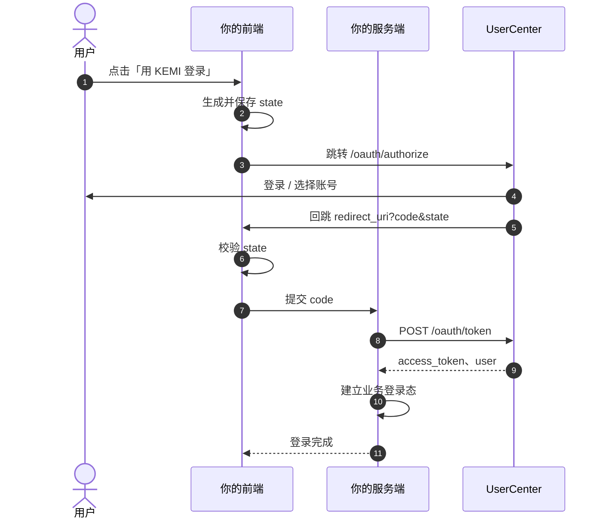
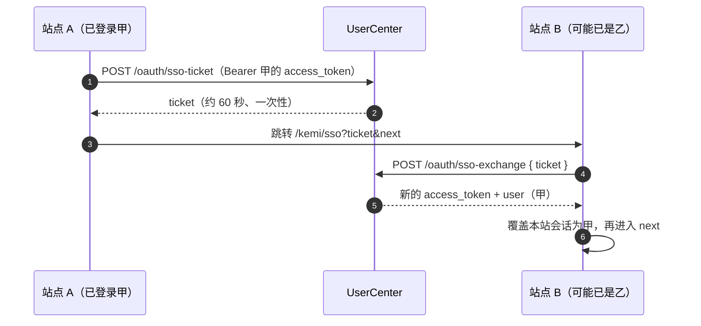

# KEMI 账号授权登录 · 网页接入

让用户用 **KEMI 账号**登录你的网站。采用 OAuth 2.0 **授权码模式**：用户在浏览器完成登录，你的**服务端**用授权码换取 `access_token`。

**本文自成一体**：按下面步骤即可完成对接，无需再读其他文档。

---

## 你将得到什么

完成接入后，用户点击「KEMI 登录」→ 在 KEMI 完成登录或选账号 → 回到你的站点并完成业务登录。

你的服务端会拿到：

- `access_token`：调用用户信息、维护登录态的凭证  
- 用户标识 `sub`（及昵称、邮箱等资料）

本接入提供：**授权码 + access_token + userinfo**。  
不提供：`id_token`、`refresh_token`。token 过期后引导用户重新授权即可。

---

## 环境与角色

| 角色 | 地址（正式环境） | 你要做的事 |
|------|------------------|------------|
| 开发者平台 | https://kemi.newlinksz.com/kd | 注册、创建 Web 应用、复制凭证、读文档 |
| UserCenter API | https://kemi.newlinksz.com/usercenter | 授权、换票、拉用户信息（**唯一对接的 API**） |
| UserCenter Web | https://kemi.newlinksz.com/uc | 用户登录页（浏览器自动跳转，无需自建） |
| 你的前端 | 自有域名 | 发起授权、接收回调、把 `code` 交给你的后端 |
| 你的服务端 | 自有后端 | 保管 `client_secret`、换票、建立业务会话 |

端点一览（也可读发现文档）：

```http
GET https://kemi.newlinksz.com/usercenter/.well-known/openid-configuration
```

| 用途 | 方法与路径 |
|------|------------|
| 授权 | `GET /oauth/authorize` |
| 换票 | `POST /oauth/token` |
| 用户信息 | `GET /oauth/userinfo` |
| 站间免登签发 ticket | `POST /oauth/sso-ticket` |
| 站间免登核销 ticket | `POST /oauth/sso-exchange` |

下文用 `{UC_API}` 表示 `https://kemi.newlinksz.com/usercenter`。

---

## 流程



职责划分：

- **前端**：跳转授权、校验 `state`、把 `code` 交给服务端  
- **服务端**：持有 `client_secret`、换票、保存会话、按需请求 userinfo  
- **`redirect_uri`**：授权与换票必须使用**同一字符串**，且与控制台登记值完全一致  

---

## 第一步：创建 Web 应用

1. 打开 [开发者平台](https://kemi.newlinksz.com/kd) 并登录  
2. 进入 **控制台 → 应用管理 → Web 应用 → 新建**  
3. 填写应用名称  
4. 填写**授权回调地址**（你的站点接收 `code` 的 URL），例如：  
   - 生产：`https://your-site.example/oauth/callback`  
   - 联调：`http://172.21.16.10:9000/oauth/callback`  
5. 创建成功后立刻复制并妥善保存：  
   - `client_id`  
   - `client_secret`（仅显示一次；遗失请在控制台重置）  

建议写入服务端环境变量：

```bash
KEMI_CLIENT_ID=...
KEMI_CLIENT_SECRET=...
KEMI_REDIRECT_URI=https://your-site.example/oauth/callback
KEMI_UC_API=https://kemi.newlinksz.com/usercenter
```

回调地址也可在创建后再到应用详情中设置，**开始联调前必须已登记**。

---

## 第二步：前端发起授权

1. 生成随机 `state`（建议不少于 16 字节随机串），写入 cookie 或 sessionStorage  
2. 将浏览器跳转到：

```http
GET {UC_API}/oauth/authorize
  ?client_id={client_id}
  &redirect_uri={redirect_uri}
  &response_type=code
  &scope=openid%20profile
  &state={state}
```

`redirect_uri` 需 URL 编码，内容与登记值一致。

3. 用户在 KEMI 完成登录后，浏览器回到：

```text
{redirect_uri}?code={授权码}&state={state}
```

4. 前端校验 `state` 与跳转前保存的值一致后，把 `code` 发给你的服务端。  

`code` 只能使用一次，约 5 分钟内有效。

若授权参数不合法（例如回调未登记），接口会直接返回 JSON，浏览器不会回跳：

```json
{
  "error": "invalid_request",
  "error_description": "redirect_uri 未登记或不匹配"
}
```

---

## 第三步：服务端换票

推荐使用表单编码（与常见 OAuth 客户端库一致）：

```http
POST {UC_API}/oauth/token
Content-Type: application/x-www-form-urlencoded

grant_type=authorization_code
&code={code}
&redirect_uri={redirect_uri}
&client_id={client_id}
&client_secret={client_secret}
```

也可使用：

- HTTP Basic：`Authorization: Basic base64(client_id:client_secret)`，body 中可省略 secret  
- JSON：字段名与上表相同，`Content-Type: application/json`

### 成功（HTTP 200）

```json
{
  "access_token": "eyJhbGciOiJSUzI1NiIsInR5cCI6IkpXVCJ9...",
  "token_type": "Bearer",
  "expires_in": 2592000,
  "scope": "openid profile",
  "user": {
    "sub": "12",
    "user_id": 12,
    "username": "demo",
    "nickname": "演示",
    "email": "a@example.com",
    "phone": null,
    "avatar": null
  }
}
```

| 字段 | 用途 |
|------|------|
| `access_token` | 凭证。后续请求用户信息时放在 `Authorization: Bearer ...` |
| `token_type` | 固定为 `Bearer` |
| `expires_in` | 有效期（秒） |
| `user` | 用户资料（KEMI 顺带返回；也可用下一步的 userinfo） |

拿到 `access_token` 后：

1. 在服务端建立业务会话（服务端 session，或你自己签发的业务 cookie）  
2. 用 `user.sub`（或 `user.user_id`）在本地用户表做 upsert  

### 失败（HTTP 400 / 401）

```json
{
  "error": "invalid_grant",
  "error_description": "授权码无效或已过期"
}
```

| `error` | 常见原因 |
|---------|----------|
| `invalid_request` | 缺少必要字段 |
| `invalid_client` | `client_id` 或 `client_secret` 不正确 |
| `invalid_grant` | `code` 无效、已使用、过期，或换票时的 `redirect_uri` 与授权时不一致 |
| `unsupported_grant_type` | `grant_type` 不是 `authorization_code` |

请读取 `error` 与 `error_description` 向用户或日志展示原因。

### 服务端示例（Node.js）

```js
// POST /your-api/kemi/callback   body: { code, state }
import express from 'express'

const UC = process.env.KEMI_UC_API // https://kemi.newlinksz.com/usercenter
const CLIENT_ID = process.env.KEMI_CLIENT_ID
const CLIENT_SECRET = process.env.KEMI_CLIENT_SECRET
const REDIRECT_URI = process.env.KEMI_REDIRECT_URI

app.post('/your-api/kemi/callback', async (req, res) => {
  // 1) 校验 state 与会话中保存的一致（略）
  const { code } = req.body
  const body = new URLSearchParams({
    grant_type: 'authorization_code',
    code,
    redirect_uri: REDIRECT_URI,
    client_id: CLIENT_ID,
    client_secret: CLIENT_SECRET
  })
  const tokenRes = await fetch(`${UC}/oauth/token`, {
    method: 'POST',
    headers: { 'Content-Type': 'application/x-www-form-urlencoded' },
    body
  })
  const data = await tokenRes.json()
  if (!tokenRes.ok || !data.access_token) {
    return res.status(400).json({ message: data.error_description || data.error || '换票失败' })
  }
  // 2) upsert 本地用户（uc_user_id = data.user.sub）
  // 3) 写业务 session / cookie
  res.json({ ok: true, user: data.user })
})
```

---

## 第四步：读取用户信息（可选）

换票响应里已有 `user` 时，可直接使用。需要稍后刷新资料时：

```http
GET {UC_API}/oauth/userinfo
Authorization: Bearer {access_token}
```

```json
{
  "sub": "12",
  "user_id": 12,
  "username": "demo",
  "preferred_username": "demo",
  "name": "演示",
  "nickname": "演示",
  "email": "a@example.com",
  "phone": null,
  "picture": null,
  "avatar": null
}
```

用户标识请使用 `sub`（字符串形式的 UC 用户 ID）。

---

## 第五步：本地用户与业务会话

建议本地表结构：

```text
user_id        本地主键
uc_user_id     唯一，对应 userinfo.sub
display_name   站内昵称（仅本产品，不写回 KEMI）
role / status  本产品权限
```

处理逻辑示例：

```text
resp = POST /oauth/token
ucId = resp.user.sub
localUser = upsert_by_uc_user_id(ucId, resp.user)
create_session(localUser)
```

若要引导用户修改手机、邮箱、全局昵称，可打开：

```text
https://kemi.newlinksz.com/uc/sso?token={access_token}&next=/account
```

---

## 站间免登（固定路径 `/kemi/sso`）

两个都已按本文接入 KEMI 的网站之间，可用**固定路径**跳转免登，**不必再向对方索取专用免登 URL**——只要知道对方站点根地址（首页 origin）即可。

### 约定

| 项 | 值 |
|----|-----|
| 路径 | `{对方站点根}/kemi/sso` |
| 查询参数 | `ticket`（必填）、`next`（可选，站内落地路径，默认 `/`） |
| 会话策略 | **一律覆盖**：目标站无论是否已登录其他账号，免登成功后都切换为 ticket 对应用户 |

示例：

```text
https://b.example.com/kemi/sso?ticket={ticket}&next=/
https://kemi.newlinksz.com/kd/kemi/sso?ticket={ticket}&next=/console/overview
```

### 流程



### API

签发（需登录）：

```http
POST {UC_API}/oauth/sso-ticket
Authorization: Bearer {access_token}
```

成功：

```json
{ "ticket": "...", "expires_in": 60 }
```

核销（目标站调用，无需 Bearer）：

```http
POST {UC_API}/oauth/sso-exchange
Content-Type: application/json

{ "ticket": "..." }
```

成功（字段与换票类似）：

```json
{
  "access_token": "...",
  "token_type": "Bearer",
  "expires_in": 86400,
  "user": { "sub": "...", "nickname": "..." }
}
```

### 发起方（站点 A）示例

```js
// 用本站已保存的 KEMI access_token 向 UC 要 ticket
const r = await fetch(`${UC_API}/oauth/sso-ticket`, {
  method: 'POST',
  headers: { Authorization: `Bearer ${accessToken}` }
});
const { ticket } = await r.json();
if (!ticket) throw new Error('签发失败');

// 只拼对方首页 origin + 固定路径
const targetOrigin = 'https://b.example.com'; // 或配置里的对方根地址
const next = '/'; // 对方站内路径
location.href =
  `${targetOrigin.replace(/\/$/, '')}/kemi/sso` +
  `?ticket=${encodeURIComponent(ticket)}` +
  `&next=${encodeURIComponent(next)}`;
```

### 接收方（站点 B）必须实现

在前端（或同域网关）提供 **GET `/kemi/sso`**：

1. 读取 `ticket`、`next`（校验 `next` 必须是以 `/` 开头的相对路径，禁止外链）  
2. `POST {UC_API}/oauth/sso-exchange` 换取 `access_token` 与 `user`  
3. **覆盖**本站登录态（清掉原用户会话，写入甲）  
4. 跳转到 `next`（缺省 `/`）  

开发者平台已按此约定实现参考入口：  
`https://kemi.newlinksz.com/kd/kemi/sso`。

### 安全说明

- 跳转 URL 里只带短时一次性 `ticket`，**不要**把长期 `access_token` 放进地址栏  
- `ticket` 约 60 秒有效、用后即废  
- 生产环境使用 HTTPS  

---

## 联调示例

从回调 URL 取出尚未使用的 `code` 后：

```bash
curl -s -X POST 'https://kemi.newlinksz.com/usercenter/oauth/token' \
  -H 'Content-Type: application/x-www-form-urlencoded' \
  -d 'grant_type=authorization_code' \
  -d 'code=PASTE_CODE' \
  -d 'redirect_uri=https://your-site.example/oauth/callback' \
  -d 'client_id=YOUR_CLIENT_ID' \
  -d 'client_secret=YOUR_CLIENT_SECRET'

curl -s 'https://kemi.newlinksz.com/usercenter/oauth/userinfo' \
  -H 'Authorization: Bearer PASTE_ACCESS_TOKEN'
```

---

## 上线前自检

- [ ] 已创建 **Web 应用**，并保存了 `client_id` / `client_secret`  
- [ ] 回调地址已在控制台登记，授权 URL 与换票请求使用同一字符串  
- [ ] 授权与换票均指向 `{UC_API}`（`8401`）  
- [ ] `client_secret` 仅存在于服务端  
- [ ] 前端校验 `state`；`code` 只使用一次  
- [ ] 业务登录态基于 `access_token`（及本地 `uc_user_id`）建立  
- [ ] 错误处理读取 `error` / `error_description`  
- [ ] （可选）已实现固定入口 `/kemi/sso`，便于其它 KEMI 站点跳转免登  

---

## 排错

| 现象 | 排查 |
|------|------|
| 授权后未回跳，页面上是 JSON | 查看 `error_description`；多半是回调地址未登记或与请求不一致 |
| `invalid_client` | 核对 `client_id` / `client_secret` 是否来自同一应用 |
| `invalid_grant` | 换新的 `code` 重试；确认授权与换票的 `redirect_uri` 完全相同 |
| 换票成功但站点仍显示未登录 | 确认已用 `access_token` 建立自己的会话 |

---

## 安全要求

- `client_secret` 只放在服务端  
- 使用随机 `state` 防止 CSRF  
- 生产环境使用 HTTPS，且 `redirect_uri` 为 https  
- 每个业务系统使用自己在控制台创建的客户端，不要共用其他应用的凭证  

---

## 注意事项

**特别说明：KEMI 账号只负责登录身份，不负责你的网站 / 应用内的访问权限。**

KEMI 登录成功只说明「用户是谁」；能否进入站点、开放哪些页面或功能，由业务方自行决定。

若不想对所有人开放，或部分页面仅限授权用户，请自行搭建账号 / 权限管理系统，并明确告知：未获本产品授权的账号，无权登录或使用该网站 / 应用。 
